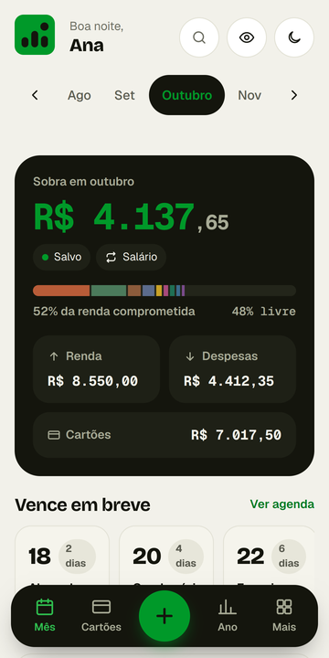
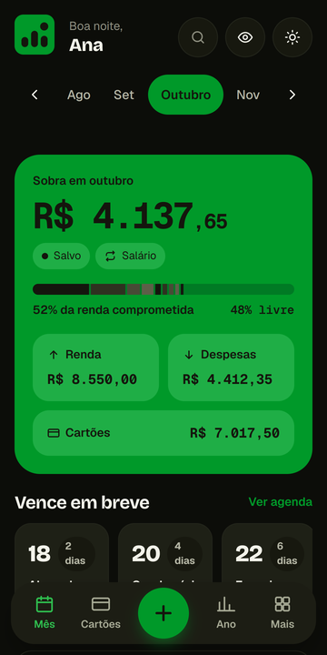
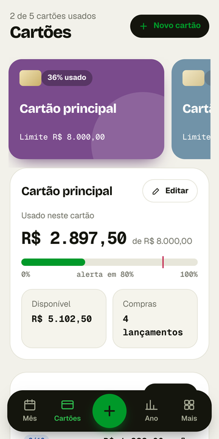
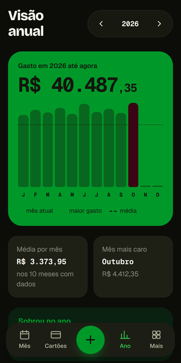
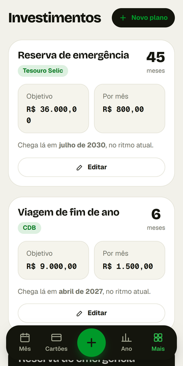
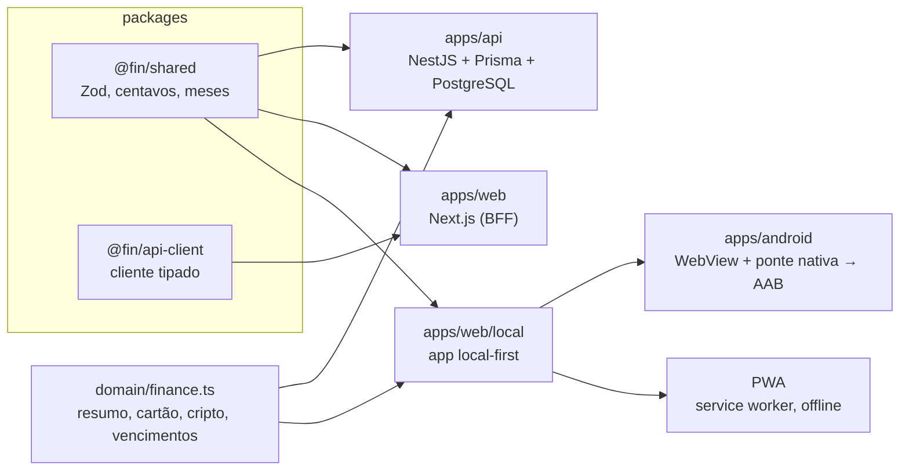

# Minhas Despesas

> Controle de despesas pessoais **offline e privado**: rendas, despesas, cartões, parcelas, vencimentos, visão anual, investimentos e cripto. Os dados ficam só no aparelho.

<p align="center">
  
  
  
  
  
</p>

Projeto pessoal de ponta a ponta: parte de um site em HTML puro com Supabase e evoluiu para um app **local-first** (Android e PWA) e uma plataforma com API, banco e site em TypeScript. Os dados das capturas acima são fictícios.

## O que existe aqui
| Peça | O que é | Estado |
|---|---|---|
| **App local** (`apps/web/local`) | O app completo, sem servidor, com os dados no aparelho. Sai como **APK/AAB (Android)** e **PWA (iPhone/Android/PC)** | Testado em Chrome; confirmado em 1 Android real |
| **Casca Android** (`apps/android`) | Projeto Gradle (alvo API 36) com WebView, ponte nativa e fluxo de build no GitHub Actions | Compila contra a API 36; build completo ainda não executado no GitHub |
| **API** (`apps/api`) | NestJS + Prisma + PostgreSQL: contas, regras financeiras, LGPD, migração do site antigo | 144 testes (banco real); **não publicada** |
| **Site** (`apps/web`) | Next.js 15 / React 19 consumindo a API (BFF com cookies e proteção CSRF) | 173 testes + e2e; **não publicado** |
| **Pacotes** (`packages/*`) | `@fin/shared` (contratos Zod, dinheiro em centavos) e `@fin/api-client` (cliente tipado) | Usados por API, site e app local |

## Decisões de engenharia que valem a leitura
- **Local-first de verdade.** O "servidor dentro do aparelho" (`apps/web/local/local-api.ts`) reaproveita as **mesmas validações e cálculos** da API real, e as regras de banco são reimplementadas e testadas (renda principal única por mês, recorrência que copia uma vez, limites). Toda alteração é "tudo ou nada": se não couber gravar, a tela volta ao estado anterior.
- **Dados em dois lugares.** `localStorage` do WebView + preferências do Android (gravação síncrona). Ao abrir, vale a cópia mais nova; se uma estiver corrompida, usa a outra. Testado, inclusive "o WebView perdeu tudo".
- **Dinheiro sempre em centavos inteiros**, validado nas bordas; sem ponto flutuante em valores.
- **Invariantes garantidas em camadas.** "Exatamente uma renda principal por mês" vale na lógica, no **índice único parcial** do PostgreSQL e em testes de concorrência (um desses testes achou um bug real de leitura obsoleta sob concorrência).
- **Segurança que foi medida, não suposta.** Política de conteúdo sem `unsafe-eval` (um teste achou que a biblioteca de validação testava `eval` e o desligamos), proteção CSRF, `helmet`, rate limit, Swagger só em desenvolvimento.
- **Acessibilidade medida.** Auditoria automática de contraste (WCAG) do site real nos dois temas; alvos de toque e teclado nos diálogos também são testados.
- **Testes que provam que pegam falhas**: além dos testes normais, foram feitas "sabotagens" manuais no código para ver se algum teste falhava.

## Arquitetura


## Começando
Requisitos: Node 22+. Para a API e o banco: Docker (ou PostgreSQL 16).

```bash
npm ci
# App local em um único HTML (abre direto no navegador)
node apps/web/local/build-local.js        # -> apps/web/dist-local/minhas-despesas-local.html
# PWA instalável (pasta pronta para qualquer hospedagem estática)
node apps/web/local/build-pwa.js          # -> apps/web/dist-pwa/
# Testes
npm test                                  # API (PostgreSQL real) + site
```
API e site completos: veja [`docs/RODAR-NO-WINDOWS.md`](docs/RODAR-NO-WINDOWS.md) e [`docs/DEPLOY-GRATUITO.md`](docs/DEPLOY-GRATUITO.md).

### Gerar o app Android
O fluxo [`android.yml`](.github/workflows/android.yml) (GitHub Actions → *Run workflow*) compila o AAB e um APK de teste. Passo a passo, chave de assinatura e publicação: [`docs/GUIA-GITHUB-E-PLAY.md`](docs/GUIA-GITHUB-E-PLAY.md).

## Documentação
[`APP-LOCAL`](docs/APP-LOCAL.md) · [`ARQUITETURA`](docs/ARQUITETURA.md) · [`REGRAS-DE-NEGOCIO`](docs/REGRAS-DE-NEGOCIO.md) · [`SEGURANCA`](docs/SEGURANCA.md) · [`DESIGN-SYSTEM`](docs/DESIGN-SYSTEM.md) · [`IOS`](docs/IOS.md) · [`MIGRACAO`](docs/MIGRACAO.md) · [`O que falta`](docs/PROXIMAS-ETAPAS.md) · [`Política de privacidade`](docs/privacidade/index.html)

## Limites conhecidos (sem enfeite)
- A API e o site **nunca foram publicados** nem rodaram com dados reais; as migrações não rodaram em banco de produção.
- O app Android foi confirmado em **um** aparelho; o build Gradle ainda não foi executado no GitHub; Android 15+ (barras do sistema) e iPhone não foram testados em aparelho real.
- Só Chromium foi usado nos testes de navegador.
- Veja [`docs/PROXIMAS-ETAPAS.md`](docs/PROXIMAS-ETAPAS.md) para a lista completa.

## English summary
Minhas Despesas is a privacy-first personal finance tracker. The flagship is a **local-first** app (Android WebView shell + installable PWA) whose data never leaves the device; it reuses the same Zod contracts and finance domain code as a NestJS/PostgreSQL API and a Next.js site (also in this monorepo). Highlights: money as integer cents, invariants enforced at three layers (service, partial unique index, concurrency tests), dual-write storage with newest-wins reconciliation, strict CSP without `unsafe-eval`, automated WCAG contrast audits, and an Android Gradle project targeting API 36 with a GitHub Actions workflow that builds the AAB. See *Known limits* above for what is not yet verified.

## Licença
[MIT](LICENSE)
